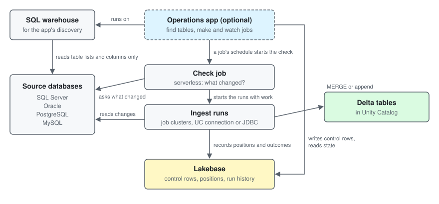

# lakefed-ingest

`lakefed-ingest` copies tables from external databases (SQL Server, Oracle, PostgreSQL, MySQL) into Delta tables on
Databricks, and keeps them up to date. You describe the tables to copy as rows of metadata; it reads each source,
writes its Delta tables and records where each one is, so the next run reads only what changed. It is built for
estates of many databases: thousands of source databases and hundreds of thousands of tables. An optional
**operations app** lets you find the tables on a source, make ingestion jobs from them and watch them run, without
writing SQL.

## Choose an implementation

This repository holds two implementations, each deployed as its own bundle. This README covers the **root
implementation**, the default, at the repository root. The **job orchestration implementation** is in
[`job_orchestration/`](job_orchestration/README.md), and the operations app is a separate bundle in [`app/`](app/README.md).

| | **Root implementation** | **Job orchestration implementation** |
|---|---|---|
| Best for | Many source databases or tables, logins per database, many databases written into shared tables, or SQL Server Change Tracking (incremental loads with deletes, no watermark column needed) | Warehouse-only compute, watermark loads from a source other than SQL Server, or a source only it supports (Redshift, Synapse, IBM Db2) |
| Incremental options | SQL Server Change Tracking, or a watermark column, on SQL Server; a full reload for every source | A watermark column on any source it supports |
| Compute model | One job task copies a whole group of tables on a job cluster | One task run per table or partition, on a SQL warehouse |

The full comparison (where the metadata lives, how each reads a source, the bundles) is in
[How a run works](docs/how-it-works.md#the-two-implementations). Upgrading from a release where the repository
root was the job orchestration implementation? Read
[Upgrading from an earlier release](docs/deploy.md#upgrading-from-an-earlier-release) before you deploy anything.

## How it works



1. **Tables to copy.** Each table is a row in Lakebase, a Postgres database on Databricks: where the table is, how
   to load it and which Delta table it writes. These *control rows* are grouped into *ingestion groups*, and an
   *ingestion job* runs one or more groups on a schedule. The app makes these rows for you; without it you insert
   them yourself.
2. **The check.** On each trigger of a job, the check job (`lakefed_ingest_check`) asks every source database whether
   anything changed since the last run. A database with nothing new is stamped as current and costs no cluster.
   (The app gives new jobs this check. A job of the other kind starts its ingest runs directly.)
3. **The ingest.** For the databases with work, the check starts ingest runs (`lakefed_ingest`) on job clusters.
   Each run reads only the changes, through SQL Server Change Tracking or a watermark column, or reloads a table in
   full, and writes them with an idempotent MERGE or an append. A table's position moves on only after its Delta
   write commits.
4. **The record.** Every run and table writes its outcome to Lakebase, so failures, freshness and history can be
   read in the app or queried from Databricks SQL.

The details (load types, tables shared by many databases, concurrency, retries, sizing) are in
[How a run works](docs/how-it-works.md).

## What you need

- A Databricks workspace with Unity Catalog and jobs compute. The setup and check jobs use serverless jobs compute
  by default; the [deployment guide](docs/deploy.md) has the alternatives.
- Lakebase. The bundle creates a Lakebase instance, which is **billable**, unless you bind an existing one.
- Network paths from the job clusters to Lakebase (port 5432) and to each source, and from serverless compute to
  each source the check reads (for example private endpoints through a network connectivity configuration).
- A way into each source: a Unity Catalog connection the jobs' identity can use (`USE CONNECTION`, plus `MANAGE`
  for the dedicated job cluster), or one secret per source database (`{"user", "password"}`) in a secret scope.
- For SQL Server Change Tracking tables: Change Tracking on, a primary key, and a change retention longer than the
  first full copy takes.
- For the app: Databricks Apps allowed in the workspace. The app's bundle makes its own small serverless SQL
  warehouse, which reads table lists and columns from the sources; it never reads table data.

The full list, with how to check each one, is in the [deployment guide](docs/deploy.md#before-you-start).

## Deploy

First, clone the repository, install a Databricks CLI version that supports bundles, and log in to the workspace
as a profile (`databricks auth login --host <workspace-url> -p <profile>`). Add a target for your workspace to both
`databricks.yml` and `app/databricks.yml` (the committed hosts are placeholders), or let the profile supply the host,
and check each bundle with `databricks bundle validate -t <target> -p <profile>`. The
[deployment guide](docs/deploy.md) has every step, setting and check. Then:

```bash
# 1. The ingestion bundle, from the repository root (bundle lakefed_ingest_v2; compute defaults to Azure node types).
databricks bundle deploy -t <target> -p <profile>
databricks bundle run lakefed_ingest_setup -t <target> -p <profile>   # once: creates the Lakebase schema

# 2. The operations app (optional), from app/, after the ingestion bundle.
cd app
databricks bundle deploy -t <target> -p <profile>
databricks bundle run lakefed_ingest_app -t <target> -p <profile>          # deploys the code and starts the app
databricks bundle run lakefed_ingest_app_grants -t <target> -p <profile>   # gives the app its access
```

Then grant `CAN_USE` on the app to the people who run ingestion, and open the URL `bundle run` printed. The app's
own settings (job ids, who manages it) are in [the operations app's deploy steps](app/README.md#deploy).

Upgrades are deploy only: pull, deploy both bundles, and the Lakebase schema migrates itself on the next run (see
[Upgrading](docs/deploy.md#upgrading)).

## Use the app

1. **Ingestion jobs > New ingestion job.** Under **What it ingests**, choose **Add tables**, then
   **Discover on a source**: pick the Unity Catalog connection, let it test, tick whole servers, databases or single
   tables, and add them. Their tables and columns are read through the app's SQL warehouse while you go on with the
   rest of the page. **Import a CSV** is the other way in, for a list of tables you already have.
2. **How it writes** and **When it runs.** Name the target catalog, schema and table pattern, and the cadence. The
   preview counts the tables and groups, and says how far the read is.
3. **Create.** Up to 5,000 tables, all read, are written before Create answers. A bigger job, or one whose tables are
   still being read, is written by a background task whose progress the page shows (reading the chosen databases'
   tables first, then writing); a database that couldn't be read stops it by name before anything is written.
4. **Turn it on.** A new job starts paused: **Paused** under When it runs is ticked by default. Untick it before
   Create, or later with **Edit**, or start one run with **Run now**. Its runs, failures and late tables show on
   **Overview**, the job's page and **Runs**.

Every page, the permissions it checks and the app's limits are described in [the operations app's README](app/README.md).

## Without the app

Insert control rows yourself, as `notebooks/load_control_example.ipynb` shows (the
[Control rows](docs/how-it-works.md#control-rows) reference lists the columns), load one secret per source
database if the rows read through Spark JDBC, then run a group, or let the check job run several:

```bash
databricks secrets put-secret <scope> <secret_key> --string-value '{"user":"..","password":".."}'
databricks bundle run lakefed_ingest -t <target> -p <profile> --params task_collection=<group>,parallelism=32
databricks bundle run lakefed_ingest_check -t <target> -p <profile> -- --task_collections "<group1>,<group2>"
```

The first run copies each table in full; later runs apply only the changes. The check job looks at a set of groups
and starts an ingest only where something changed. Both jobs ship with paused schedules.

## Read more

| Page | What it covers |
|---|---|
| [Deployment guide](docs/deploy.md) | Every deploy step and setting, compute choices, steps outside the bundle, the first run, upgrades and schema changes |
| [How a run works](docs/how-it-works.md) | The two implementations compared, load types, change detection, shared and append tables, concurrency, table retries, settings for large estates, control rows |
| [Operations app](app/README.md) | The app's pages, discovery through the SQL warehouse, JDBC connections, re-discovery, the security model |
| [Monitoring](docs/monitoring.md) | The telemetry tables and ready queries for failures, freshness and run history |
| [Lakebase schema](docs/lakebase_schema.md) | Every Lakebase table and column, removing tables and old history, changing the schema |
| [Scale study](docs/scale.md) | A dated simulation report of the app's paths at 100,000 and 5.28 million tables; its figures are estimates, not current guidance |
| [SQL Server source profiler](tools/source_profile.sql) | A read-only script to size a SQL Server estate: table sizes, Change Tracking settings, how much changes |

## Tests

The unit tests need no cluster or database. From the repository root:

```bash
python3 -m venv .venv
.venv/bin/pip install pytest httpx -r app/src/requirements.txt
.venv/bin/pytest                              # every suite (test paths in pytest.ini)
.venv/bin/pytest tests                        # the root implementation only
.venv/bin/pytest job_orchestration/tests      # the job orchestration implementation only
```

Some tests are skipped unless their outside system is given: the Postgres tests (`*_pg_test.py`) need
`LAKEFED_APP_TEST_PG` or `LAKEFED_TEST_PG` naming a Postgres server, and `tests/validation_test.py` runs against a
live SQL Server when the `LAKEFED_TEST_SQLSERVER_*` environment variables are set.

For a dev or test source, `tests/synthetic/` builds a SQL Server database with 1,800 Change Tracking tables, applies
changes to it, and reconciles the Delta tables with the source; see [tests/synthetic/README.md](tests/synthetic/README.md).

## Not yet supported

The `cdc` load strategy (a placeholder with a documented contract in `load_strategies.py`), watermark and `cdc` loads
for sources other than SQL Server (placeholders), and built-in alerts beyond the jobs' failure emails
([Monitoring](docs/monitoring.md) has the queries an alert can run).

## Help and security

This project is not covered by Databricks Support. For usage questions or defects,
[open a GitHub issue](https://github.com/databricks-solutions/lakefed-ingest/issues/new); responses are best effort.
To report a security vulnerability, follow [SECURITY.md](SECURITY.md) and do not open a public issue.

## License

&copy; 2026 Databricks, Inc. All rights reserved. The source in this repository is provided subject to the Databricks License [https://databricks.com/db-license-source]. All included or referenced third party libraries are subject to the licenses set forth below.

| library | description | license | source |
|---|---|---|---|
| ag-grid-community | Data grid (operations app) | MIT | https://github.com/ag-grid/ag-grid |
| ag-grid-react | React wrapper for AG Grid (operations app) | MIT | https://github.com/ag-grid/ag-grid |
| certifi | Mozilla CA bundle (live SQL Server validation tests) | MPL-2.0 | https://pypi.org/project/certifi/ |
| @databricks/design-system | The Databricks design system's CSS tokens, copied into the operations app (`app/src/frontend/src/dbui/tokens.css`) | ISC | https://www.npmjs.com/package/@databricks/design-system |
| databricks-sdk | Databricks SDK for Python | Apache-2.0 | https://pypi.org/project/databricks-sdk/ |
| DM Sans | Font of the operations app (`app/src/frontend/src/dbui/DMSans-variable.woff2`, from the design system) | SIL Open Font License 1.1 | https://github.com/googlefonts/dm-fonts |
| fastapi | Web framework for APIs (operations app) | MIT | https://pypi.org/project/fastapi/ |
| httpx | HTTP client (operations app API tests) | BSD-3-Clause | https://pypi.org/project/httpx/ |
| ibm_db | IBM Db2 driver (Db2 test data generator, job orchestration implementation) | Apache-2.0 | https://pypi.org/project/ibm-db/ |
| Microsoft JDBC Driver for SQL Server | SQL Server JDBC driver (included in Databricks Runtime) | MIT | https://github.com/microsoft/mssql-jdbc |
| MySQL Connector/J | MySQL JDBC driver (optional cluster library) | GPL-2.0 with Universal FOSS Exception | https://github.com/mysql/mysql-connector-j |
| Oracle JDBC driver (ojdbc11) | Oracle JDBC driver (optional cluster library) | Oracle Free Use Terms and Conditions | https://www.oracle.com/downloads/licenses/oracle-free-license.html |
| pandas | Data manipulation and analysis (table profiler notebook) | BSD-3-Clause | https://pypi.org/project/pandas/ |
| PostgreSQL JDBC Driver | PostgreSQL JDBC driver (included in Databricks Runtime) | BSD-2-Clause | https://github.com/pgjdbc/pgjdbc |
| psycopg | PostgreSQL database adapter (v3), for Lakebase | LGPL-3.0 | https://pypi.org/project/psycopg/ |
| pydantic | Data validation using Python type hints (operations app) | MIT | https://pypi.org/project/pydantic/ |
| pyspark | Apache Spark Python API (provided by Databricks Runtime) | Apache-2.0 | https://pypi.org/project/pyspark/ |
| pytest | Testing framework | MIT | https://pypi.org/project/pytest/ |
| python-tds | SQL Server TDS client (live SQL Server validation tests) | MIT | https://pypi.org/project/python-tds/ |
| react | Library for building user interfaces (operations app) | MIT | https://github.com/facebook/react |
| react-dom | React DOM rendering (operations app) | MIT | https://github.com/facebook/react |
| react-router-dom | Routing for React (operations app) | MIT | https://github.com/remix-run/react-router |
| @tanstack/react-query | Data fetching and caching for React (operations app) | MIT | https://github.com/TanStack/query |
| @types/react | TypeScript types for React (operations app, build only) | MIT | https://github.com/DefinitelyTyped/DefinitelyTyped |
| @types/react-dom | TypeScript types for React DOM (operations app, build only) | MIT | https://github.com/DefinitelyTyped/DefinitelyTyped |
| typescript | TypeScript compiler (operations app, build only) | Apache-2.0 | https://github.com/microsoft/TypeScript |
| uvicorn | ASGI web server (operations app) | BSD-3-Clause | https://pypi.org/project/uvicorn/ |
| vite | Frontend build tool (operations app, build only) | MIT | https://github.com/vitejs/vite |
| @vitejs/plugin-react | React support for Vite (operations app, build only) | MIT | https://github.com/vitejs/vite-plugin-react |

Notices for the files the operations app ships with it:
- **@databricks/design-system** (ISC): Copyright (c) Databricks, Inc. Permission to use, copy, modify, and/or
  distribute this software for any purpose with or without fee is hereby granted, provided that the above copyright
  notice and this permission notice appear in all copies. THE SOFTWARE IS PROVIDED "AS IS" AND THE AUTHOR DISCLAIMS
  ALL WARRANTIES WITH REGARD TO THIS SOFTWARE INCLUDING ALL IMPLIED WARRANTIES OF MERCHANTABILITY AND FITNESS. IN NO
  EVENT SHALL THE AUTHOR BE LIABLE FOR ANY SPECIAL, DIRECT, INDIRECT, OR CONSEQUENTIAL DAMAGES OR ANY DAMAGES
  WHATSOEVER RESULTING FROM LOSS OF USE, DATA OR PROFITS, WHETHER IN AN ACTION OF CONTRACT, NEGLIGENCE OR OTHER
  TORTIOUS ACTION, ARISING OUT OF OR IN CONNECTION WITH THE USE OR PERFORMANCE OF THIS SOFTWARE.
- **DM Sans** (SIL Open Font License, Version 1.1): Copyright 2014 The DM Sans Project Authors
  (https://github.com/googlefonts/dm-fonts). This Font Software is licensed under the SIL Open Font License,
  Version 1.1, available with a FAQ at https://openfontlicense.org.
