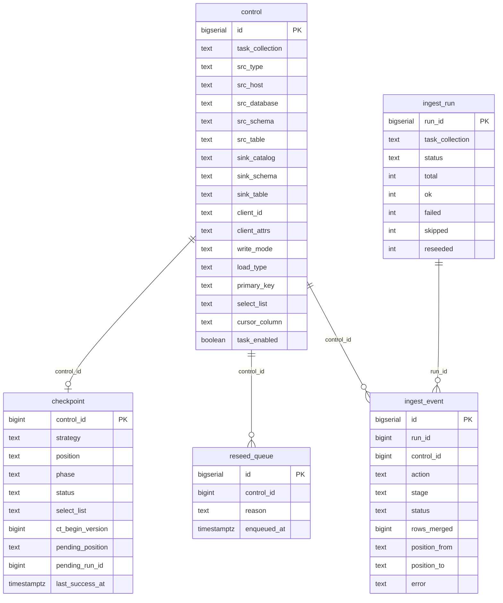
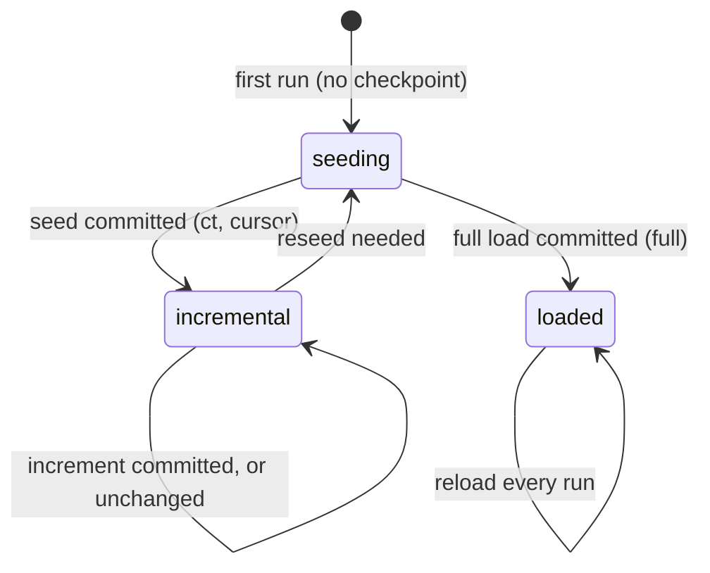

# Lakebase schema

All state for the default version lives in one Lakebase (Postgres) database, schema
`lakefed_ingest`. The DDL is [`src/lakefed_ingest/lakebase_schema.sql`](../src/lakefed_ingest/lakebase_schema.sql),
applied and migrated by the `lakefed_ingest_setup` job. The database is registered in Unity Catalog
(default catalog `lakefed_ingest_lakebase`), so every table below can be queried from a SQL warehouse
as `lakefed_ingest_lakebase.lakefed_ingest.<table>` (see [monitoring.md](monitoring.md)).

| Table | Role | Written by |
|---|---|---|
| `control` | **Configuration.** One row per source table to ingest | You (load control rows) |
| `checkpoint` | **State.** Where each table is: phase, resume position, status, freshness | The ingestion job |
| `reseed_queue` | **Log.** Every reseed the job queued, and why | The ingestion job |
| `ingest_run` | **Telemetry.** One row per job run | The ingestion job |
| `ingest_event` | **Telemetry.** One row per table per run | The ingestion job |



The diagram shows the key columns only; the full lists are below. The relationships are logical
(by id) and not enforced with foreign keys. Deleting a `control` row leaves its checkpoint and
history behind, which is harmless: a row added again later gets a new `id`, so it seeds from
scratch.

## `control` — what to ingest

One row per (source database, table). You maintain it; the job only reads it (one query per run,
for the run's `task_collection`). See "Control rows" in the [README](../README.md) and
`notebooks/load_control_example.ipynb`.

| Column | Meaning |
|---|---|
| `id` | Primary key. Checkpoints and telemetry refer to it as `control_id` |
| `task_collection` | Which run ingests this row. One job run = one collection |
| `task_enabled` | `false` skips the row without deleting its state |
| `tier`, `priority` | Order within a run (`tier`, then `priority`, then `id`) |
| `src_type` | Source adapter: `sqlserver` \| `oracle` \| `postgresql` \| `mysql` |
| `src_host`, `src_port` | Source server; NULL port = the engine's default |
| `src_database`, `src_schema`, `src_table` | Source table (Oracle: `src_database` is the service name) |
| `secret_key` | Secret (in the job's secret scope) holding JSON `{"user", "password"}` for this database |
| `use_remote_query` | `true`: read through the Unity Catalog connection in `src_connection` (`remote_query`) instead of Spark JDBC; `src_host`, `src_port` and `secret_key` aren't used then. Default `false` |
| `src_connection` | The connection read through when `use_remote_query` is `true`. Otherwise only a fallback for the host when `src_host` is NULL |
| `jdbc_options` | Optional JSON object of extra Spark JDBC read options |
| `select_list` | Explicit, comma-separated columns to copy (`*` isn't supported). Adding a column reseeds the table |
| `primary_key` | Comma-separated; required for `ct`, `cursor` and `cdc` (MERGE key) |
| `sink_catalog`, `sink_schema`, `sink_table` | Target Delta table |
| `client_id` | Optional. Set it to share one sink across many source databases; written to the sink column `__client_id__` |
| `client_attrs` | Optional JSON object `{column: value}`: identity columns written (as STRING) on every row, e.g. the tenant name or source server |
| `write_mode` | `merge` (default): the sink mirrors the source table. `append` (`ct` and `full`): the sink is a change log (see "Append sinks" in the [README](../README.md)) |
| `load_type` | Load strategy: `ct` \| `cursor` \| `full` (`cdc` is a placeholder) |
| `cursor_column` | `cursor` only: the high-watermark column (rowversion recommended) |
| `load_partitioned`, `partition_col`, `partition_size_mb` | Optional partitioned seed / full load for large tables |
| `ct_enabled` | Informational for `ct` rows; the job checks Change Tracking on the source itself |
| `cdc_capture_instance` | Reserved for the placeholder `cdc` strategy |
| `job_name`, `src_catalog`, `warehouse_id`, `enable_iceberg_reads`, `sink_cluster_cols`, `source_instance_group` | Not used by this version (shared with the job orchestration version, or reserved). Leave NULL / default |

**Constraints.** CHECK constraints reject invalid combinations, for example:
- `ct` on a source other than SQL Server, or without a primary key;
- `cursor` without `cursor_column`;
- partitioned settings that are incomplete;
- `jdbc_options` or `client_attrs` that isn't a JSON object;
- `use_remote_query` without `src_connection`;
- a malformed `client_id`;
- `write_mode` other than `merge` / `append`, or `append` with a load type other than `ct` / `full`.

A unique index allows only one row per sink, or one row per (sink, `client_id`) for shared sinks,
so two rows can never overwrite each other's data.

## `checkpoint` — where each table is

One row per control row (`control_id` is the primary key), created on the table's first run and
updated after every successful write. The job reads all of a collection's checkpoints in one query
at the start of a run.

| Column | Meaning |
|---|---|
| `control_id` | The control row this state belongs to |
| `src_database`, `src_schema`, `src_table` | Copied from control, for readability |
| `strategy` | Load strategy that wrote the row (`ct`, `cursor`, `full`). A different `load_type` in control means a reseed |
| `phase` | `seeding` (needs a full copy) → `incremental` (seeded; applying increments, for `ct` and `cursor`); `loaded` for `full` |
| `position` | Resume point, owned by the strategy. `ct`: the source database's CT version. `cursor`: JSON `{"col", "type", "value"}` (the watermark). `full`: NULL |
| `status`, `detail` | `ok` or `failed`, with the last error in `detail` |
| `select_list` | Columns the sink was last written with; compared with `control.select_list` to detect added columns |
| `ct_begin_version` | `ct`: the table's Change Tracking begin version at seed time. A change means CT was turned off and on, so the table reseeds |
| `pending_position`, `pending_run_id` | Append sinks (`ct`): set just before a change or seed append, to the position it reaches and the run writing it; cleared when the checkpoint advances. Set at the start of a run means the last run stopped in between: the job checks the sink for that run's rows before doing anything else with the table. A `full` append isn't marked: each run appends one complete snapshot tagged with its `__run_id`, so a run that stopped after its commit leaves a complete snapshot and the next run appends its own |
| `last_success_at` | When the table last ingested successfully, used for freshness and lag |
| `updated_at` | Last change to this row |

**Lifecycle.** Checkpoints only move forward after the Delta commit succeeds, so a failure never
skips data; the next run redoes that window and the MERGE is idempotent.



A table reseeds when Change Tracking retention lapsed, CT was turned off or re-enabled on it,
`select_list` gained columns, `cursor_column` changed, or `load_type` changed.

**Forcing a reseed.** Set the phase back to `seeding`; the next run copies the table again:

```sql
update lakefed_ingest.checkpoint set phase = 'seeding' where control_id in (...);
```

## `reseed_queue` — reseed log

One row every time the job queues a reseed: the table, its `control_id`, `reason`
(`retention_miss`, `schema_change`, `ct_disabled`, `ct_reenabled`, `ct_version_reset`) and
`enqueued_at`. It's an audit log. The reseed itself happens because the same step sets the
checkpoint's phase to `seeding`. `processed` / `processed_at` are reserved and not currently set.

## `ingest_run` — one row per run

Inserted when a run starts (`status = 'running'`) and finalized when it ends.

| Column | Meaning |
|---|---|
| `run_id` | Primary key; `ingest_event.run_id` refers to it |
| `task_collection` | Collection the run ingested |
| `job_run_id`, `cluster_id` | The Databricks job run and cluster, for cross-referencing the Jobs UI |
| `parallelism` | The run's concurrency budget |
| `started_at`, `finished_at` | Timing |
| `status` | `running` → `completed` \| `failed` (any table failed); `skipped` when another run of the same collection held the lock |
| `total`, `ok`, `failed` | Table counts |
| `skipped` | Tables that were unchanged (nothing to read) |
| `reseeded` | Tables queued for a reseed |
| `detail` | JSON with run details: change-detection counts per route, timings, peak concurrency, and with `max_queries_per_source` set, each source's share and peak permits (`source_caps`), the rows batched appends committed (`batch_rows`, with `batch_rows_unknown` tables not counted), and table retry totals (`table_retries`) |

## `ingest_event` — one row per table per run

Inserted when a table starts (`status = 'running'`) and updated when it finishes. Tables that fail
before any work (stage `plan` or `detect`) also get a `failed` event. CT tables that skip-no-change
finds unchanged don't get an event: they're advanced in bulk, counted in `ingest_run.skipped`, and
their `checkpoint.last_success_at` is still stamped. Cursor tables always get one, with no rows
when the watermark hasn't moved.

| Column | Meaning |
|---|---|
| `id` | Primary key |
| `run_id`, `task_collection`, `control_id` | Which run and which control row |
| `src_database`, `src_schema`, `src_table`, `sink_fqn` | Source and target, copied for convenience |
| `action` | `seed`, `increment`, `reseed` or `full` |
| `phase` | Checkpoint phase when the table started |
| `stage` | How far it got: `plan`, `detect`, `verify` (checking a pending append), `ensure_sink`, `read`, `seed`, `merge`, `load`, `checkpoint`. On a failure, this is where it failed |
| `status` | `running` → `ok` \| `failed`; `skipped` for a reseed that was only queued (no data copied); `retried` for an attempt that failed and was tried again in the same run (`table_retries`), so the table has a later row for its next attempt |
| `started_at`, `finished_at`, `duration_ms` | Timing |
| `rows_read`, `rows_merged` | Row counts from the Delta commit metrics (NULL when the runtime doesn't report them) |
| `position_from`, `position_to` | Checkpoint position before and after (CT version, or cursor value) |
| `pool` | Spark FAIR pools the table's work ran in |
| `error` | Error message for a failed or retried attempt, with its deepest Java cause when Spark's message leaves it out |
| `retry_count` | Earlier attempts of this table in the run: 0 for the first, 1 for the first retry. Write-conflict retries inside an attempt are logged in the job output only |

Telemetry tables grow with every run. To keep long-term history cheaply, snapshot them to Delta
(see [monitoring.md](monitoring.md)) and prune old rows from Lakebase.
